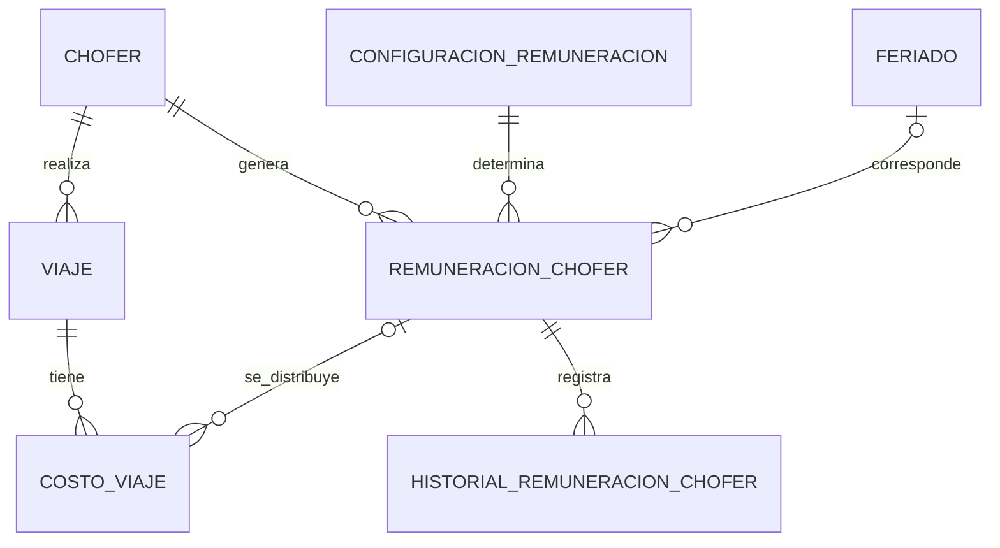

# MER: fecha del viaje y remuneración diaria

Los nombres siguientes coinciden con `schema.sql`. Las entidades no enumeradas no cambian.

## Entidades existentes

### VIAJE

`id_viaje` INTEGER PK; `id_vehiculo` INTEGER FK → VEHICULO; `id_chofer` INTEGER FK → CHOFER;
`fecha` DATE NOT NULL; `estado` VARCHAR(30) REGISTRADO/ANULADO; `fecha_anulacion` TIMESTAMP nullable;
`motivo_anulacion` VARCHAR(150) nullable.

Se sustituyen `fecha_inicio` y `fecha_fin` por `fecha`. Cada viaje pertenece a un único día;
no se registran horarios ni pernoctaciones. El recorrido, las entregas y la aplicación de tarifas se conservan.

### CHOFER

Se conservan los atributos existentes. `tipo_remuneracion` admite **DIARIO_FIJO** y **DIA_TRABAJADO**.
La migración convierte SUELDO y POR_VIAJE respectivamente. La modalidad histórica se copia al registro diario.

### COSTO_VIAJE

`id_costo` INTEGER PK; `id_viaje` INTEGER FK → VIAJE; `tipo_costo` VARCHAR(100);
`valor` NUMERIC(12,2); `descripcion` TEXT nullable;
**`id_remuneracion_chofer` INTEGER FK nullable → REMUNERACION_CHOFER**.

El vínculo es obligatorio para CHOFER y debe ser nulo para otros conceptos.
UNIQUE (`id_viaje`, `id_remuneracion_chofer`). Los importes asociados son asignaciones del costo diario.

## Entidades nuevas

### CONFIGURACION_REMUNERACION

| Atributo | Tipo / restricción |
|---|---|
| id_configuracion_remuneracion | INTEGER PK |
| importe_diario | NUMERIC(12,2), mayor que cero |
| adicional_dia_especial | NUMERIC(12,2), no negativo |
| fecha_inicio | DATE, obligatorio |
| fecha_fin | DATE, nullable, inclusive |
| observacion | TEXT, nullable |

Configuración global con períodos no superpuestos. Una configuración puede utilizarse en muchas remuneraciones.
Una vez utilizada, no se modifican sus importes ni se dejan fuera fechas ya utilizadas.

### FERIADO

| Atributo | Tipo / restricción |
|---|---|
| id_feriado | INTEGER PK |
| fecha | DATE UNIQUE, obligatorio |
| descripcion | VARCHAR(150), obligatorio |
| observacion | TEXT, nullable |

Los domingos se detectan por calendario. No requieren una fila en FERIADO.
No se altera el calendario de fechas que ya tienen remuneraciones generadas.

### REMUNERACION_CHOFER

| Atributo | Tipo / restricción |
|---|---|
| id_remuneracion_chofer | INTEGER PK |
| id_chofer | INTEGER FK → CHOFER |
| id_configuracion_remuneracion | INTEGER FK → CONFIGURACION_REMUNERACION |
| id_feriado | INTEGER FK nullable → FERIADO |
| fecha | DATE, obligatorio |
| tipo_remuneracion_aplicado | VARCHAR(20): DIARIO_FIJO / DIA_TRABAJADO |
| trabajo_realizado | BOOLEAN |
| es_domingo | BOOLEAN |
| importe_base | NUMERIC(12,2), no negativo |
| importe_adicional | NUMERIC(12,2), no negativo |
| total | NUMERIC(12,2), base + adicional |
| estado | VARCHAR(10): ABIERTO / CERRADO |
| fecha_creacion | TIMESTAMP |
| fecha_cierre | TIMESTAMP nullable |
| observacion | TEXT nullable |

UNIQUE (`id_chofer`, `fecha`). Existe una remuneración por chofer y día, aunque haya varios viajes.

### HISTORIAL_REMUNERACION_CHOFER

| Atributo | Tipo / restricción |
|---|---|
| id_historial_remuneracion_chofer | INTEGER PK |
| id_remuneracion_chofer | INTEGER FK → REMUNERACION_CHOFER |
| accion | VARCHAR(10): CIERRE / REAPERTURA |
| fecha | TIMESTAMP |
| motivo | TEXT obligatorio |
| responsable | TEXT obligatorio |

Estructura reservada: todavía no se generan eventos porque cierre y reapertura están bloqueados.
Al implementar usuarios, `responsable` deberá vincularse a una identidad autenticada mediante la migración correspondiente;
no se aceptará una identidad enviada libremente por el frontend. No existe todavía una relación con USUARIO.

## Relaciones

No se incluyen pagos a choferes. El cliente mantiene sus roles de pago fuera del sistema.
